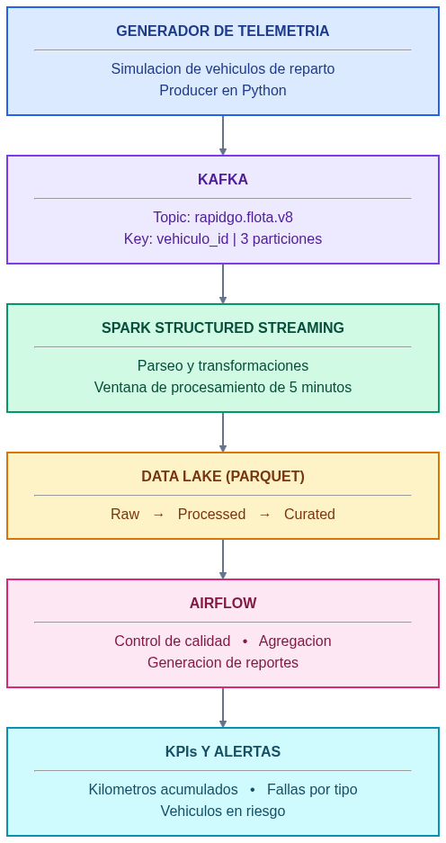
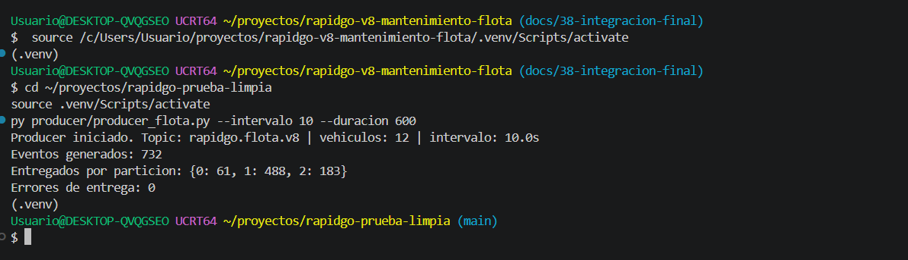
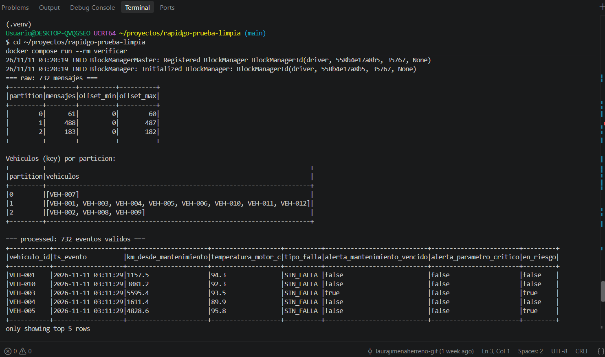
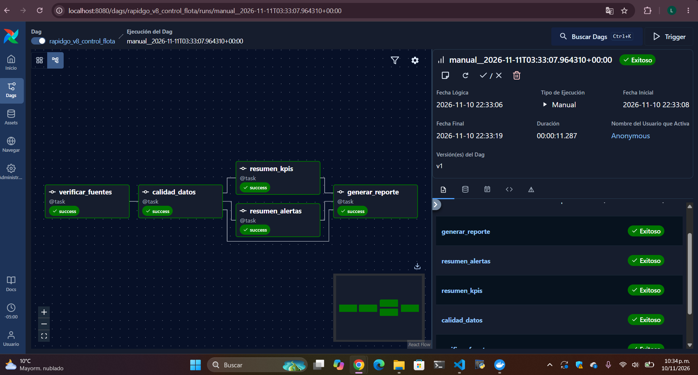
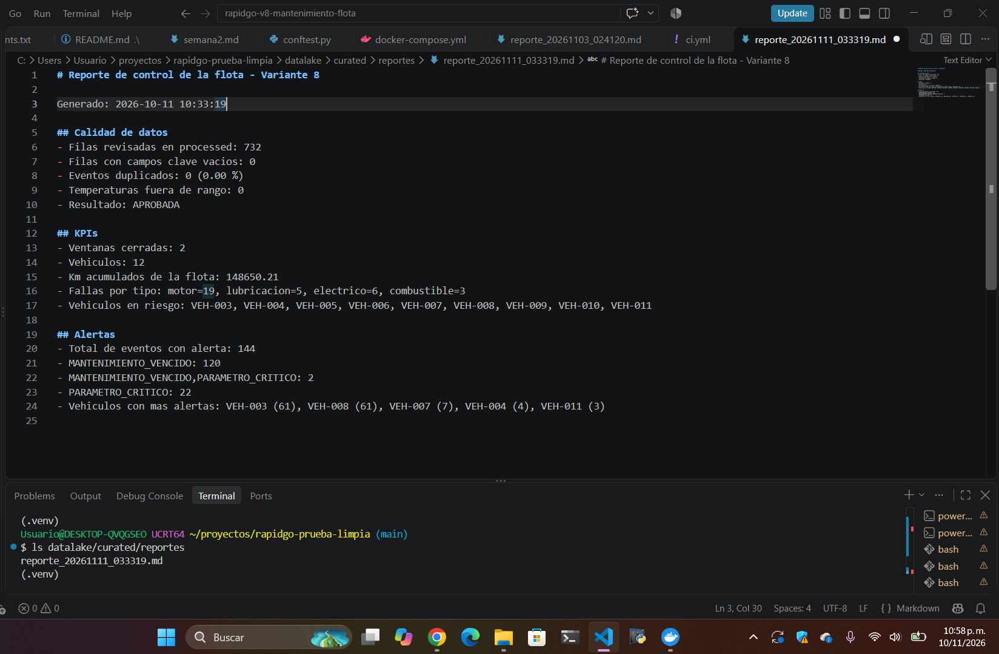

# RapidGo - Variante 8: Mantenimiento de flota


**Proyecto final - Línea de Profundización I - Big Data**
Ingeniería de Sistemas y Computación - Facatativá

[Ver el video de presentación del proyecto](https://www.youtube.com/watch?v=3b6D5sNmkPA)

## Equipo
| Integrante | Usuario GitHub |
|---|---|
| Laura Jimena Herreño | @laurajimenaherreno-gif |
| Johan Alan Torres | @AlanT218 |
| Edwin Felipe Garavito | @felipegaravito888 |

## Variante
Variante 8: **Mantenimiento de flota**.

- Eventos: vehículo, kilometraje, temperatura, código de falla y uso.
- KPIs: km acumulados, fallas por tipo y vehículos en riesgo.
- Alertas: mantenimiento vencido y parámetro mecánico crítico.

## Problema de negocio y valor de la solución
RapidGo es una plataforma de entregas. En la variante 8 se analiza el riesgo de falla
de los vehículos usados en el reparto. El pipeline recibe telemetría de cada vehículo
(kilometraje, temperatura, códigos de falla y uso), calcula cuántos kilómetros
acumula la flota, qué fallas ocurren y qué vehículos están en riesgo, y genera alertas
cuando hay un mantenimiento vencido o un parámetro mecánico crítico.

El valor de la solución es que RapidGo puede ver a tiempo qué vehículos necesitan
mantenimiento o tienen un parámetro crítico, y programar la revisión antes de que el
vehículo falle durante el reparto.

## Arquitectura


Flujo completo: Producer → Kafka → Spark Structured Streaming → Data Lake (raw, processed, curated) → Airflow → reporte y alertas.

| Tecnología | Versión | Rol en la variante 8 |
|---|---|---|
| Producer (Python y confluent-kafka) | Python 3.9 o superior | Simula 12 vehículos de reparto y envía cada lectura como evento JSON |
| Apache Kafka | 3.9.0 | Recibe los eventos en el topic `rapidgo.flota.v8`, con key `vehiculo_id` y 3 particiones |
| Apache Spark Structured Streaming | 4.2.0 | Lee de Kafka, parsea los eventos, aplica transformaciones, calcula alertas y KPIs por ventana de 5 minutos |
| Data Lake (Parquet) | - | Guarda los datos en las capas raw, processed y curated, con checkpoint |
| Apache Airflow | 3.2.2 | Orquesta el DAG de verificación, calidad, resumen y reporte, con reintentos y XCom |
| Docker Compose | - | Levanta Kafka y Airflow y lanza los jobs de Spark en local |
| pytest | - | Prueba las reglas de negocio, el contrato del evento, el generador, la calidad de datos y el DAG |
| GitHub Actions | - | Valida el código y el DAG en cada push y Pull Request |
| GitHub (Issues, Projects, PR y Releases) | - | Da trazabilidad al trabajo del equipo |

Transversal: Docker + Git + GitHub + Kanban + GitHub Actions + Releases.

### Capas del Data Lake
| Carpeta | Contenido |
|---|---|
| `datalake/raw` | Mensaje de Kafka tal cual, con partición y offset |
| `datalake/processed` | Evento parseado y transformado, con alertas y riesgo calculados |
| `datalake/curated/alertas` | Solo los eventos que activan alguna alerta, con su motivo |
| `datalake/curated/kpi_vehiculo_ventana` | KPIs por vehículo y ventana de 5 minutos |
| `datalake/curated/reportes` | Reporte que genera el DAG de Airflow |
| `datalake/_checkpoints` | Checkpoints de Spark |

## Prerrequisitos
- Docker Desktop abierto, con `docker compose`.
- Git y una terminal Bash. En Windows se usa Git Bash.
- Python 3.9 o superior. Lo probamos con 3.9 en local y con 3.13 en el CI.
- Los puertos 9092 (Kafka) y 8080 (Airflow) libres.
- Tres terminales, una para Spark, una para el producer y una para comandos.

## Cómo ejecutar el pipeline en local
Los comandos están escritos para Git Bash en Windows. En Linux o macOS se usa `python3` en lugar de `py` y `source .venv/bin/activate` para activar el entorno. `MSYS_NO_PATHCONV=1` solo hace falta en Git Bash.

### 1. Clonar el repositorio
```bash
git clone https://github.com/laurajimenaherreno-gif/rapidgo-v8-mantenimiento-flota.git
cd rapidgo-v8-mantenimiento-flota
```

### 2. Levantar Kafka
```bash
docker compose up -d kafka
docker compose ps
```
Se levanta solo Kafka para ahorrar memoria. Un `docker compose up -d` sin nombre también arrancaría Airflow. El servicio `kafka` debe aparecer en estado `Up`.

### 3. Crear el topic con 3 particiones
```bash
MSYS_NO_PATHCONV=1 docker exec rapidgo-v8-kafka /opt/kafka/bin/kafka-topics.sh --bootstrap-server localhost:9092 --create --topic rapidgo.flota.v8 --partitions 3 --replication-factor 1
MSYS_NO_PATHCONV=1 docker exec rapidgo-v8-kafka /opt/kafka/bin/kafka-topics.sh --bootstrap-server localhost:9092 --describe --topic rapidgo.flota.v8
```
El topic no se crea solo, porque `KAFKA_AUTO_CREATE_TOPICS_ENABLE` está en falso y un topic automático tendría una sola partición (ADR-001). Hay que crearlo cada vez que Kafka se levanta desde cero. El `describe` debe mostrar `PartitionCount: 3`.

### 4. Iniciar Spark (terminal 1)
```bash
docker compose run --rm spark
```
Se queda corriendo. La primera vez tarda más porque descarga la imagen y el conector de Kafka. Usa una ventana de 5 minutos, watermark de 1 minuto y salida en Parquet. Se pueden cambiar con las variables `VENTANA`, `WATERMARK` y `SALIDA`.

### 5. Enviar eventos con el producer (terminal 2)
```bash
py -m venv .venv
source .venv/Scripts/activate
pip install -r producer/requirements.txt
py producer/producer_flota.py --intervalo 10 --duracion 600
```
Dura 10 minutos y envía 732 eventos, 61 lecturas de cada uno de los 12 vehículos. Al terminar imprime los eventos generados, los entregados por partición y los errores de entrega. Conviene dejarlo correr completo, porque los KPIs se escriben cuando se cierra cada ventana de 5 minutos.

### 6. Detener Spark
Cuando el producer termine, espera a que Spark deje de mostrar avisos de lote atrasado y detenlo con `Ctrl + C`. Al detenerlo aparece un traceback con `KeyboardInterrupt`, que es normal porque lo interrumpe el usuario.

### 7. Verificar el Data Lake (terminal 3)
```bash
docker compose run --rm verificar
```
Muestra los conteos por capa, los offsets por partición, las alertas y los KPIs.

### 8. Ejecutar Airflow
```bash
docker compose stop kafka
docker compose up -d airflow
```
Se detiene Kafka porque el DAG solo lee archivos del Data Lake y así se ahorra memoria. Espera 1 o 2 minutos, porque Airflow instala pyarrow al arrancar. Luego da permisos de escritura a la carpeta `curated`, que creó Spark:
```bash
MSYS_NO_PATHCONV=1 docker compose exec -u root airflow chmod -R a+rwx /opt/airflow/datalake/curated
```
Sin ese paso, la tarea `generar_reporte` falla con `PermissionError`. Después abre http://localhost:8080, que no pide usuario ni contraseña, entra al DAG `rapidgo_v8_control_flota` y pulsa **Trigger**.

### 9. Apagar y limpiar
```bash
docker compose down
rm -rf datalake/raw datalake/processed datalake/curated datalake/_checkpoints
```
El segundo comando borra los datos del Data Lake. Con `docker compose down` también se pierden las variables y el historial de Airflow.

## Topics, eventos, KPIs y reglas principales

### Topic
`rapidgo.flota.v8`, con 3 particiones, 1 réplica y key `vehiculo_id`. Así todas las lecturas de un vehículo van a la misma partición y se leen en orden (ADR-001 y ADR-002).

### Evento
```json
{
  "event_id": "9d4e1c7a-2b6f-4f0e-8a3d-5c1b7e9f2a40",
  "vehiculo_id": "VEH-007",
  "tipo_vehiculo": "moto",
  "timestamp": "2026-10-19T14:20:05Z",
  "kilometraje": 18450.7,
  "km_ultimo_mantenimiento": 14200.0,
  "temperatura_motor_c": 112.4,
  "codigo_falla": "P0217",
  "horas_uso": 6.5
}
```
El campo `codigo_falla` es opcional y los demás son obligatorios. El contrato completo está en [docs/contrato-evento.md](docs/contrato-evento.md).

### Catálogo de fallas
| Código | Tipo | Severidad |
|---|---|---|
| P0217 | MOTOR | CRITICA |
| P0524 | LUBRICACION | CRITICA |
| P0300 | MOTOR | MEDIA |
| P0562 | ELECTRICO | MEDIA |
| P0171 | COMBUSTIBLE | BAJA |

### KPIs
Se calculan por vehículo en ventanas de 5 minutos.

| KPI | Cómo se calcula |
|---|---|
| Km acumulados | Último valor del odómetro de cada vehículo, y km recorridos en la ventana (máximo menos mínimo) |
| Fallas por tipo | Cantidad de eventos con falla de tipo MOTOR, LUBRICACION, ELECTRICO y COMBUSTIBLE |
| Vehículos en riesgo | Vehículos que cumplen al menos una condición de riesgo |

### Reglas de alerta y de riesgo
| Regla | Condición |
|---|---|
| Alerta de mantenimiento vencido | Más de 5000 km desde el último mantenimiento |
| Alerta de parámetro crítico | Temperatura del motor mayor a 110 °C, o falla de severidad CRITICA (P0217 o P0524) |
| Vehículo en riesgo | 4500 km o más desde el último mantenimiento (90 % del intervalo), temperatura de 100 °C o más, o falla de severidad CRITICA |

El estado de un vehículo se resume con esta prioridad: CRITICO, VENCIDO, EN_RIESGO y NORMAL. La justificación de cada umbral está en [docs/kpis-y-alertas.md](docs/kpis-y-alertas.md).

## Orquestación con Airflow
El DAG `rapidgo_v8_control_flota` (carpeta `airflow/dags/`) revisa y resume los datos del Data Lake. Se ejecuta a mano con **Trigger** desde http://localhost:8080 y tiene 5 tareas.

1. `verificar_fuentes` comprueba que existan datos en raw, processed, curated/alertas y curated/kpi_vehiculo_ventana.
2. `calidad_datos` revisa la capa processed (nulos en campos clave, duplicados, temperaturas fuera de rango y kilometrajes inconsistentes) y frena el resto si los datos no pasan.
3. `resumen_kpis` y `resumen_alertas` resumen los KPIs por ventana y las alertas por motivo y vehículo.
4. `generar_reporte` guarda el reporte en `datalake/curated/reportes`.

Las tareas se pasan información con XCom y todas tienen 2 reintentos con 20 segundos de espera. Los resultados de cada tarea se ven en la pestaña XCom de la tarea.

Para probar el fallo controlado, se crea en **Administración, Variables** la variable `fallo_controlado` con valor `si`, y `calidad_datos` falla a propósito. Para recuperar, se cambia el valor a `no` y se limpia la tarea. La decisión está en el [ADR-003](docs/decisions/ADR-003-fallo-controlado-y-recuperacion.md).

## Pruebas y GitHub Actions
Las pruebas se ejecutan en local con:

```bash
py -m pytest -v
```

| Archivo | Pruebas | Qué cubre |
|---|---|---|
| `tests/test_reglas.py` | 19 | Reglas de negocio, umbrales y estado del vehículo |
| `tests/test_contrato.py` | 22 | Contrato del evento y valores inválidos |
| `tests/test_generador.py` | 5 | Eventos del producer |
| `tests/test_calidad.py` | 17 | Calidad de datos, resúmenes y reporte del DAG |
| `tests/test_dag.py` | 4 | Importación y estructura del DAG (necesita Airflow) |

En local, sin Airflow instalado, `test_dag.py` se omite y el resultado es 63 pruebas aprobadas y 1 omitida.

El workflow `CI RapidGo V8` corre en cada push a `main` y `develop`, en cada Pull Request hacia `main` y de forma manual desde la pestaña Actions con **Run workflow**. Tiene tres jobs.

| Job | Qué hace |
|---|---|
| `validar` | Revisa la sintaxis de Python, ejecuta las pruebas, guarda el reporte de pruebas como artefacto y valida el `docker-compose.yml` |
| `validar-dag` | Instala Airflow y ejecuta las pruebas del DAG |
| `quality-gate` | Solo pasa si `validar` y `validar-dag` pasaron. Es la condición para crear el tag del release |

Cada verificación y el error que evita están explicados en [docs/ci-decisiones.md](docs/ci-decisiones.md).

## Resultados y evidencias
La prueba final se hizo el 10 de noviembre de 2026 desde una copia limpia del repositorio. El detalle completo está en [docs/resultados-finales.md](docs/resultados-finales.md).

| Qué se midió | Resultado |
|---|---|
| Eventos del producer | 732 generados, con `{0: 61, 1: 488, 2: 183}` por partición y 0 errores de entrega |
| Capa raw | 732 mensajes, con offsets del 0 al 60, del 0 al 487 y del 0 al 182 |
| Capa processed | 732 eventos válidos, los mismos que llegaron a raw |
| Alertas | 144 eventos con alerta. Los mayores fueron MANTENIMIENTO_VENCIDO en VEH-003 y VEH-008 con 60 cada uno |
| KPIs | 24 filas, una por vehículo y ventana cerrada |
| DAG de Airflow | 5 tareas en verde. Terminó en 11,3 segundos después de corregir los permisos |
| Fallo controlado | Con el fallo activo la ejecución tardó 45 segundos en fallar. Al recuperarla, `calidad_datos` terminó en el intento 4, en 2,0 segundos |

El reparto entre particiones es desparejo porque cada vehículo siempre cae en la misma partición. La partición 1 recibió el 66,7 % de los mensajes, la 2 el 25,0 % y la 0 el 8,3 % (ADR-002).









## Limitaciones conocidas y trabajo futuro

### Limitaciones
- **Reparto desparejo.** Con 12 claves y 3 particiones, la partición 1 recibe dos tercios del tráfico (ADR-002).
- **Lotes de Spark atrasados.** Con un intervalo de 10 segundos, cada lote tardó entre 10,2 y 24,0 segundos.
- **Muchos archivos pequeños.** La carpeta `curated/kpi_vehiculo_ventana` quedó con decenas de archivos Parquet pequeños.
- **Airflow en modo desarrollo.** Usa `standalone` e instala pyarrow al arrancar, y sus propios avisos indican que es solo para desarrollo.
- **Estado de Airflow temporal.** Las variables y el historial de ejecuciones se pierden con `docker compose down`.
- **Permisos.** Hay que dar permisos de escritura a `datalake/curated` antes de ejecutar el DAG.
- **Reintentos.** No ayudan cuando el error se repite igual en cada intento, como en el fallo controlado (ADR-003).
- **Topic manual.** Debe crearse a mano con 3 particiones.
- **Datos simulados.** Son 12 vehículos y los umbrales son iniciales, ajustables según el fabricante.

### Trabajo futuro
- Repartir mejor los mensajes, con más particiones o con otra estrategia de key.
- Ajustar el intervalo de Spark y compactar los archivos Parquet.
- Guardar la base de datos de Airflow en un volumen, usar una imagen propia con pyarrow y programar la ejecución del DAG.
- Ajustar los umbrales por marca y modelo de vehículo, con datos reales.

## Contribuciones
| Integrante | Responsabilidades | Issues | Pull Requests principales |
|---|---|---|---|
| Laura Jimena Herreño (@laurajimenaherreno-gif) | Estructura inicial del repositorio, ADR-001, docker-compose con Kafka, Spark Streaming con Parquet y alertas, reglas de negocio y CI base, DAG de Airflow con tarea de calidad, checkpoints de las Semanas 1 y 2, integración final y README | #1, #6, #7, #8, #10, #11, #12, #13, #24, #38 | #16, #19, #20, #22, #25, #27, #29, #30, #42, #44, #45 |
| Johan Alan Torres (@AlanT218) | KPIs y reglas de alerta con umbrales, diagrama de arquitectura, producer de telemetría, job validar-dag en el CI, ADR-003 y ajuste del checkpoint de la Semana 3 | #4, #5, #9, #14, #36 | #17, #18, #26, #31, #33, #37 |
| Edwin Felipe Garavito (@felipegaravito888) | Contrato del evento y catálogo de fallas, ADR-002, checkpoint de la Semana 3, quality gate y artefacto de pruebas en el CI | #3, #23, #34, #40 | #21, #28, #35, #43 |

En la Semana 4 se integró el pipeline completo con evidencias (#42), se completó el CI con el quality gate (#43) y se entregó este README. El detalle de issues, Pull Requests, revisiones y ejecuciones de Actions está en las pestañas Issues, Pull requests y Actions del repositorio.

## Video de demostración
[Ver el video en YouTube](https://www.youtube.com/watch?v=3b6D5sNmkPA)

El video dura menos de 10 minutos y los tres integrantes participan. Muestra el problema y la variante, la arquitectura, la ejecución con Docker, Kafka, Spark, el Data Lake y Airflow, el trabajo en GitHub, los resultados y las lecciones aprendidas.

## Documentación
- [Contrato del evento](docs/contrato-evento.md)
- [KPIs y reglas de alerta](docs/kpis-y-alertas.md)
- [ADR-001: key y particiones de Kafka](docs/decisions/ADR-001-key-y-particiones-kafka.md)
- [ADR-002: clave de partición vehiculo_id](docs/decisions/ADR-002-clave-particion-vehiculo-id.md)
- [ADR-003: fallo controlado y recuperación](docs/decisions/ADR-003-fallo-controlado-y-recuperacion.md)
- [Checkpoint Semana 1](docs/checkpoints/semana1.md)
- [Checkpoint Semana 2](docs/checkpoints/semana2.md)
- [Checkpoint Semana 3](docs/checkpoints/semana3.md)
- [Cómo ejecutar el pipeline en local](docs/ejecucion-local.md)
- [Decisiones de CI](docs/ci-decisiones.md)
- [Resultados de la integración final](docs/resultados-finales.md)

## Estado del proyecto
- [x] Semana 1: diseño y organización (v0.1.0-foundation)
- [x] Semana 2: pipeline Kafka → Spark → Data Lake y CI (v0.2.0-streaming)
- [x] Semana 3: Airflow, calidad y resiliencia (v0.3.0-orchestration)
- [x] Semana 4: integración final (v1.0.0)

## Tablero Kanban
https://github.com/users/laurajimenaherreno-gif/projects/1
