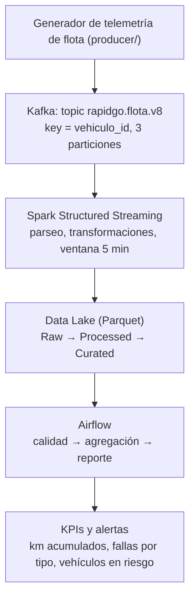

# RapidGo - Variante 8: Mantenimiento de flota

**Proyecto final - Línea de Profundización I - Big Data**
Ingeniería de Sistemas y Computación - Facatativá

## Equipo
| Integrante | Usuario GitHub |
|---|---|
| Laura Jimena Herreño | @laurajimenaherreno-gif |
| Johan Alan Torres | @AlanT218 |
| Edwin Felipe Garavito | @felipegaravito888 |

## Variante
Variante 8: **Mantenimiento de flota**.

- Eventos: vehículo, kilometraje, temperatura, código de falla y uso.
- KPIs: km acumulados, fallas por tipo y vehículos en riesgo.
- Alertas: mantenimiento vencido y parámetro mecánico crítico.

## Problema de negocio
RapidGo es una plataforma de entregas. En la variante 8 se analiza el riesgo de falla
de los vehículos usados en el reparto. El pipeline recibe telemetría de cada vehículo
(kilometraje, temperatura, códigos de falla y uso), calcula cuántos kilómetros
acumula la flota, qué fallas ocurren y qué vehículos están en riesgo, y genera alertas
cuando hay un mantenimiento vencido o un parámetro mecánico crítico.

## Arquitectura

Transversal: Docker + Git + GitHub + Kanban + GitHub Actions + Releases.

## Estado del proyecto
- [x] Semana 1: diseño y organización (v0.1.0-foundation)
- [ ] Semana 2: pipeline Kafka → Spark → Data Lake y CI
- [ ] Semana 3: Airflow, calidad y resiliencia
- [ ] Semana 4: integración y release v1.0.0

## Tablero Kanban
https://github.com/users/laurajimenaherreno-gif/projects/1